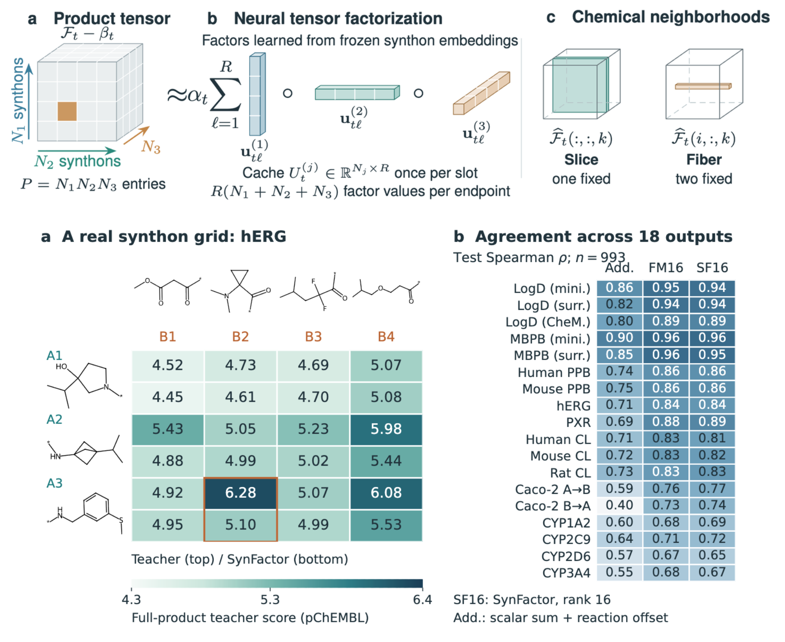

# SynFactor

**Learn small synthon vectors once. Predict product properties by multiplying them.**

SynFactor distills a full-molecule property model into a neural rank-16 CP
factorization (CP16). A small neural network learns 16 numbers per synthon,
slot and endpoint. Cache those factors, then score compatible combinations
without assembling products or running the molecular encoder again.

A research MVP with plain Python scripts, a bundled example space, CPU/GPU
training, and two- and three-synthon scoring. No SynFactor package install or
access to private repositories is needed.



The figure reports a separate research experiment: 993 test routes,
18 teacher outputs, and additive/factorization-machine comparisons. **12 of 18
CP16 outputs exceed test Spearman 0.8**; hERG is about 0.84, while CYP outputs
are weaker. These are correlations with model predictions, not experimental
ADMET measurements. The small example below uses a different space and split;
it does not reproduce the figure's exact numbers.
[Archived research metrics](benchmarks/paper_model_summary.csv).

## Quick start

Python 3.11 is tested. Create an environment and install dependencies; for CUDA,
use a PyTorch build compatible with your driver. The pinned Torch wheel is large.

```bash
git clone https://github.com/mireklzicar/synfactor.git
cd synfactor
python -m venv .venv
source .venv/bin/activate
pip install -r requirements.txt

python prepare.py --out runs/rdkit
python train.py --data runs/rdkit
python score.py --cache runs/rdkit/factors.npz --reaction 11a --top-k 20
```

This offline demo uses Morgan counts plus four RDKit descriptors as synthon
inputs, and **assembled-product RDKit Crippen logP** as the target. It
demonstrates fitting and caching; it is not an hERG model.

The bundled SynthonOR slice has **6,273 synthon records, 42 reactions and 990,829
combinations**, including two three-component reactions. The default run samples
3,000 products. Our CPU run obtained **test Spearman 0.977** on 614 products;
training took about 7 seconds after preparation. This is an easy descriptor
demonstration, not evidence of comparable ADMET accuracy.
[Recorded demo results](benchmarks/demo_rdkit_metrics.json).

Outputs in `runs/rdkit/`:

- `products.csv`, `synthons.csv`, `dataset.npz`, `dataset.json`: samples,
  teacher labels, frozen embeddings, split and provenance.
- `model.pt`, `metrics.json`, `test_predictions.csv`: trained network and
  held-out agreement, including separate two-/three-component results.
- `factors.npz`: float16 factors, affine coefficients and row identities.
  This cache is all the scoring stage needs.

For a three-synthon example:

```bash
python score.py --cache runs/rdkit/factors.npz --reaction 274552a --top-k 20
```

`score.py` streams matrix blocks and keeps only top-k values. Add `--minimize`
to select low scores. It returns synthon combinations and approximate scores,
not validated hits. Assemble and rescore final selections with the original
teacher before relying on them.

## CheMeleon / OpenADMET hERG

The adapter uses the frozen molecular encoder and original property head from
an OpenADMET checkpoint. On first use it downloads the pinned upstream model;
OpenADMET downloads CheMeleon's foundation weights when required. Subsequent
runs reuse cached weights. Upstream model licenses apply.

```bash
pip install -r requirements-openadmet.txt

python prepare.py --teacher openadmet --repository herg-chemeleon-baseline \
  --samples 3000 --device cuda --out runs/herg
python train.py --data runs/herg --device cuda
python score.py --cache runs/herg/factors.npz --reaction 11a \
  --minimize --device cuda --out runs/herg/hits.csv
```

The fresh-environment example obtained **hERG test Spearman 0.886** on 614
products (584 two-component, 30 three-component). Encoding its 2,732 unique
capped synthons took 1.5 seconds; labeling 3,000 assembled products took 2.7
seconds on the RTX 4090. Download/loading and chemistry preparation are separate.
[Example metrics](benchmarks/demo_herg_metrics.json) and
[preparation timings](benchmarks/demo_herg_dataset.json).

Use `--device cpu` throughout without CUDA. To reuse an existing model, add
`--model-dir /path/to/model` to `prepare.py`; the path may contain
`anvil_training/` or point directly to it. `--foundation-root` resolves local
relative foundation paths for minimol/surrogate models.

All nine research repositories are pinned in [teachers.py](teachers.py):
hERG; permeability/LogD/PPB; CYP1A2/2D6/3A4/2C9; microsomal clearance; PXR;
and minimol/surrogate LogD and MBPB models. Change `--repository` and use a new
output directory. Multi-output models train all endpoints together;
`score.py --target 0` selects an endpoint by its order in `dataset.json`.
Other compatible OpenADMET Chemprop models can use `--model-dir`; this adapter
does not cover every OpenADMET architecture.

## How it works

For an endpoint, the learned slot heads produce vectors u, v and optionally w:

```python
# Rank R = 16; alpha/beta include learned and target-normalization scalars.
two_synthon_score = alpha * (u * v).sum() + beta
three_synthon_score = alpha * (u * v * w).sum() + beta

# Two-slot Cartesian grid, with one synthon vector per matrix row:
scores = alpha * (A @ B.T) + beta

# Three slots, in bounded blocks of (i, j) pairs:
scores = alpha * ((A[i] * B[j]) @ C.T) + beta
```

The frozen molecular encoder provides 2,048-dimensional inputs for the research
CheMeleon/OpenADMET models. A `2048 → 64 → 64` shared network with three slot
heads learns factors against **assembled-product teacher values**. Only the
small factor network is trained, using Huber loss, AdamW and validation-based
early stopping.

After training, encode each unique capped synthon once and cache the factors.
Storage is `2 × M × T × R` bytes for M synthon-slot records, T endpoints and
float16 factors. Scoring uses float32 arithmetic. The bundled one-endpoint
cache is 200,736 factor bytes. Expensive molecular inference scales with the
synthon count; **visiting every product still costs time proportional to the
product count**.

## hERG: a billion, a trillion, twenty trillion

Measured on **one NVIDIA RTX 4090, 24 GB**, under concurrent GPU load on
2026-11-13. The large values are **linear extrapolations**, not completed
trillion-product screening runs. Each row names the stages included.

| hERG operation | 1 billion | 1 trillion | 20 trillion |
| --- | ---: | ---: | ---: |
| CheMeleon/OpenADMET, loaded teacher inference | 6.2 days | 17.0 years | 340 years |
| Teacher plus initial molecular graph preparation | 7.1 days | 19.3 years | 386 years |
| CP16, cached two-slot GPU matrix scoring + affine | 0.023 seconds | 23 seconds | **7.7 minutes** |
| CP16, same scoring + copy every float32 score to CPU RAM | 0.292 seconds | 4.9 minutes | **1.62 hours** |

Calculations from the median measured times:

```text
Teacher: 4,953 assembled products / 2.66091 seconds = 1,861 products/second
CP16: 32,768 × 29,100 = 953,548,800 distinct synthon-row tuples
      953,548,800 / 0.0220345 seconds = 43.27 billion scores/second
Time(N) = N × measured_seconds / measured_count
1 trillion = 1,000 billion; 20 trillion = 20,000 billion
```

Teacher graph preparation took a further 0.3594 seconds for that batch. Teacher
inference includes batch iteration and copying predictions to CPU; loading is
excluded. CP16 was tiled at 4096 × 4096 with GPU-resident factors, TF32-enabled
matrix multiplication and float32 outputs. A checked block differed from a
float64 reference by at most about 4.1e-7.

**“Under 10 minutes” is an extrapolation of the cached two-synthon matrix
kernel.** It excludes teacher/student training, synthon encoding/cache creation,
assembly, ranking/filtering and disk output. It is not a measured end-to-end
20-trillion screen, nor a measured trisynthon throughput. The code supports
trisynthons, but pair-factor construction and slot sizes change the rate.
Distinct synthon tuples may also produce duplicate molecular identities.

Saving 20 trillion float32 scores creates **80 TB** before IDs/metadata;
writing that alone takes about **22 hours at a sustained 1 GB/s**. Streaming
top-k/filtering avoids the full output table but adds work beyond matrix scoring.

### Reproduce the timings

The exact learned matrices used for the large two-slot benchmark are bundled
as a 1.8 MB [factor-only fixture](benchmarks/herg_two_slot_factors.npz), with
[provenance/hashes](benchmarks/herg_two_slot_factors.json). No full-library
structures or teacher checkpoint are included. This fixture is separate from
the small SynthonOR chemistry demo.

```bash
python benchmark.py --device cuda --out runs/gpu_kernel.json
python benchmark.py --device cuda --copy-to-host --out runs/gpu_host_copy.json
python benchmark_teacher.py --products runs/herg/products.csv --device cuda
```

Each matrix sweep covers 953.5 million distinct row combinations; blocks are
discarded after use. CUDA synchronization surrounds timed sweeps and warmup is
excluded. The teacher command measures newly sampled example products, so its
rate differs from the archived 4,953-product dataset.
[Raw original measurements](benchmarks/rtx4090_herg.json).

### Precomputation

Original research caches for all 18 outputs were 1.05 GB (Freedom: 1,822,466
synthon-slot records, 309,466 unique capped molecules) and 1.22 GB (Enamine:
2,119,892 records, 445,578 unique capped molecules). We do **not** have an
archived complete wall-clock build time. Earlier rough encoding-only estimates
were about 6 minutes per model for Freedom and 8–9 minutes for Enamine, inferred
from a mixed product/synthon teacher batch including startup. Those are not
measured cache-build durations.

`prepare.py` records actual capping/assembly, loading, synthon encoding and
product-labeling times; `train.py` records fitting and factor-export times.
The cached factors are reusable for all subsequent scoring requests.

## Validation and limitations

The demo deduplicates canonical products before a deterministic 70/10/20
train/validation/test hash split. Normalization uses training data only;
validation selects the checkpoint. Synthons/reactions can be shared across
splits; this is not a scaffold or reaction holdout.

The figure comes from a different research dataset and protocol. This repo
reproduces the main idea and a small experiment, not all runs behind the figure.
The original route split had eight test products also present in fitting via
other routes; removing them changed correlations by less than 0.004. Neural
figure results average three initializations. The additive comparison also
changes the input representation, so it does not isolate multiplicative
interactions from better embeddings.
Capping removes attachment context; uncappable synthons and failed assemblies
are excluded and counted. High global correlation does not guarantee recall
in a selected tail. CYP and three-component predictions were weaker in the
research study. Teacher agreement is not experimental ADMET validation.

```bash
python -m unittest discover -s tests -v
```

## Files and credits

| File | Purpose |
| --- | --- |
| `model.py` | Neural factor network, tuple scores, streamed Cartesian algebra |
| `chemistry.py`, `prepare.py` | Example chemistry, sampling, labels, embeddings |
| `teachers.py` | RDKit demo and pinned OpenADMET/CheMeleon adapters |
| `train.py`, `score.py` | Fit, export factors and rank combinations |
| `benchmark.py`, `benchmark_teacher.py` | GPU/CPU timing and extrapolations |

Credit to Jackson Burns and collaborators for
[CheMeleon](https://github.com/JacksonBurns/chemeleon), the
[OpenADMET team](https://github.com/OpenADMET/openadmet-models) for the released
models, and [Chemprop](https://github.com/chemprop/chemprop) for molecular message
passing. See the [hERG model card](https://huggingface.co/openadmet/herg-chemeleon-baseline).
The example space and reaction schemas come from
[SynthonOR](https://github.com/mireklzicar/synthonor); attribution/hashes are in
[data/README.md](data/README.md). Code is MIT licensed; upstream weights retain
their own licenses. CP factorization is an established method; the focus here
is learning reusable synthon factors from a molecular teacher and using them
for fast combinatorial scoring.
