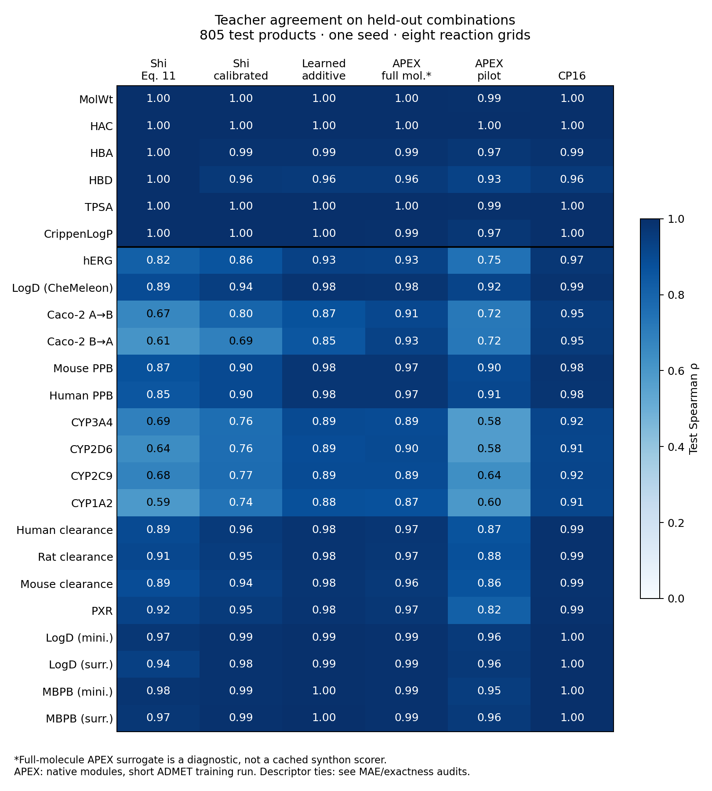

# Prior-art comparison: initial results

Run on 2026-11-13. **4,400 unique products, eight reaction grids, 18 ADMET
teacher outputs and six RDKit descriptors.** There are 3,180 training, 415
validation and 805 test products. All 290 basis-product structures belong to
training. This is a single-seed test of unseen combinations of known synthons,
not unseen chemistry or experimental ADMET validation.

[Protocol, source references and reproduction commands](../../experiments/README.md).

## Teacher approximation

| Method | hERG Spearman | hERG MAE (pChEMBL) | Median Spearman across 18 ADMET outputs |
| --- | ---: | ---: | ---: |
| Shi Eq. 11 | 0.816 | 0.267 | 0.879 |
| Shi + train-only affine calibration | 0.860 | 0.212 | 0.919 |
| Fitted additive synthon lookup | 0.934 | 0.150 | 0.976 |
| APEX pilot, factorized | 0.748 | 0.304 | 0.865 |
| CP16 | 0.970 | 0.100 | 0.983 |
| APEX full-molecule surrogate, diagnostic | 0.928 | 0.195 | 0.971 |

CP16 improves over the fitted additive control on all 18 ADMET outputs in this
run. The largest correlation gains are permeability: Caco-2 A→B improves from
0.867 to 0.950 and B→A from 0.853 to 0.954. Several LogD/PPB outputs are already
almost additive. For hERG, mean within-reaction Spearman is 0.953 for CP16 and
0.934 for the fitted additive control, so the improvement also appears within
grids. The separate two-/three-slot hERG correlations are 0.963/0.974 for CP16.

**The APEX result is an unfinished training comparison.** It uses the actual
upstream neural modules, but only 1,500 iterations per stage, with a molecular
encoder trained from scratch on this small dataset. The selected checkpoints
are iteration 1,400 for the molecular surrogate and 1,300 for factorization.
The hERG drop from 0.928 to 0.748 exposes a substantial factorization error.
Longer training and convergence checks are needed before interpreting a gap
as a limitation of APEX. CP16 inherits pretrained molecular features. The
fitted additive lookup is therefore particularly useful as a separate control
for additive expressiveness on these known grids.

Shi's raw formula uses 290 teacher evaluations; the fitted methods use 3,180
training labels and 415 validation labels. This is not an equal-oracle-budget
comparison. CP16 fitting took about 329 seconds in total across ten models
(nine ADMET teachers plus descriptors); the two APEX stages took about 226
seconds together. These are pilot training wall times on a shared RTX 4090,
not isolated performance benchmarks. They exclude teacher/model preparation.

[PDF figure](comparison.pdf) · [All metrics](metrics.csv) ·
[Per-reaction metrics](per_reaction_metrics.csv) · [Both-tail retrieval](retrieval.csv)

## Constrained retrieval

Among the 805 held-out products, minimize predicted hERG pChEMBL while keeping
LogD between 2.384 and 4.500. Those bounds are fixed using the validation
teacher's quartiles. There are 389 teacher-feasible test candidates. Retrieve
20 candidates with each approximation, then evaluate them with the full-product
teachers.

| Method | Recovery of teacher's true top 20 | Selected candidates satisfying teacher LogD constraint |
| --- | ---: | ---: |
| Shi Eq. 11 | 5/20 | 14/20 |
| Shi + calibration | 8/20 | 16/20 |
| Fitted additive | 10/20 | 18/20 |
| APEX pilot | 2/20 | 16/20 |
| CP16 | 15/20 | 17/20 |
| APEX full-molecule surrogate, diagnostic | 9/20 | 19/20 |

CP16 improves recovery in this query but does not have the highest constraint
precision. This is a small exhaustive ranking audit, not a trillion-scale
optimization run. The native `apex_topk` search extension was not benchmarked.
[Query definition](query_definition.json) · [Query metrics](constrained_query.csv).

## Descriptors and SpaceProp applicability

The Shi basis-product formula reproduces all six classical descriptors on all
4,400 pilot products to numerical precision (largest absolute error below
`1.3e-12`). HAC/HBA/HBD histograms from integer convolution match enumerated
counts exactly on all eight grids. This is strong evidence that these
descriptor controls do not require CP16 on the selected chemistry.

**Native SpaceProp was not run: no executable/license was available.** Our
code is a limited additive-histogram control, not a SpaceProp reimplementation.
For the larger bundled space, it computes the HAC distribution over 985,500
combinations in 41 reactions using about 0.413 seconds of synthon feature
calculation and 0.016 seconds of schema checks/convolution. It excludes reaction
`270196a`, whose template needs additional atom accounting. Counts describe
syntactic combinations conditional on successful assembly, without product
deduplication or an exhaustive invalid-assembly audit.

[Exactness audit](descriptor_additivity.csv) ·
[Pilot histogram counts](descriptor_histograms.json) ·
[Larger-space HAC result](full_space_hac.json).

## Scientific reading

The promising result is improved approximation and retrieval for ADMET outputs
with interactions between synthons. Classical descriptor composition and fast
descriptor distributions have strong prior art and work exactly here with
simple methods. The fitted additive control is already competitive for many
ADMET outputs, which narrows where interaction modeling adds value.

The next substantial demonstration should combine a harder chemistry split
with constrained screening and full-teacher verification of retrieved hits.
APEX factorization should first receive a convergence-controlled training run
before it is used in a paper's comparative claims. These pilot results do not
establish a general ranking across methods or chemical spaces.

Integrity checks confirm disjoint canonical-product splits, training-only
basis products, finite predictions, and additive reconstruction of the Shi,
fitted-additive and APEX cached scores. See [checks](integrity_checks.json),
[teacher hashes](teacher_provenance.json), [foundation hashes](foundation_assets.json),
[APEX provenance](apex_provenance.json), [CP training curves](training.json),
[APEX surrogate curve](apex_surrogate_training.json),
[APEX factorization curve](apex_factorizer_training.json), and
[environment versions](environment.json) and [source/input hashes](source_hashes.json).
