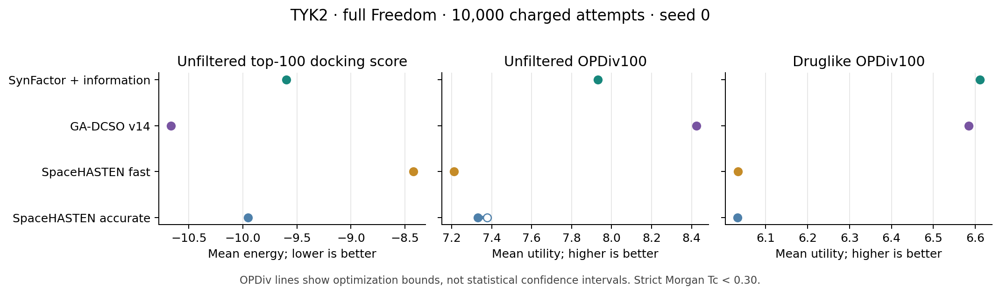

# First full-Freedom result: TYK2, seed 0

**Mixed result:** SynFactor beats both SpaceHASTEN variants on OPDiv100, but
trails GA-DCSO v14 on unfiltered scores and OPDiv. After the production
druglike-v1 filter, SynFactor has a small certified OPDiv advantage over GA.
One target and seed cannot establish a general method ranking.

All methods receive 10,000 charged attempts, including the identical 1,000 warm
observations. Failed attempts and retrospectively filtered chemistry stay
charged. SynFactor searches the complete 296,350,180,179-route Freedom release
after each refit; its nine batches contain 700 exploit/diversity, 200 information
and 100 random choices. All methods searched without a prospective druglike gate.

| Method | Unfiltered molecular top-100 mean ↓ | Unfiltered OPDiv100 ↑ | Druglike OPDiv100 ↑ |
| --- | ---: | ---: | ---: |
| SynFactor CP64 + information | −9.60007 | 7.93245 | **6.61089** |
| GA-DCSO v14 | **−10.66600** | **8.42479** | 6.58477 |
| SpaceHASTEN fast | −8.42417 | 7.21263 | 6.03381 |
| SpaceHASTEN accurate | −9.95294 | [7.33173, 7.37857] | 6.03256 |

Portfolios contain 100 unique molecules with pairwise Morgan Tanimoto
**strictly below 0.30** (radius 2, 2048 bits, no chirality). OPDiv is mean
negative docking energy: larger is better. Point values are certified optima
under the recorded numerical tolerances; the SpaceHASTEN accurate interval is
a feasible lower bound and full-domain upper bound, not a confidence interval.
Ordinary top-100 is also molecule-based. The original-form druglike gate is
unchanged; no neutralization, parent standardization or tautomer processing.

The raw best SynFactor score was −11.110, with 9,952 valid observations.
Recorded search/fitting/scoring took **3.57 minutes**, docking stages
**14.48 minutes**, and elapsed time from initial launch **25.86 minutes**,
including transport, assembly/preflight and a repaired infrastructure failure.
This is not a hardware-matched runtime comparison with the historical baselines.

## What to improve next

Only 614 SynFactor molecules pass druglike-v1. Of 6,300 exploitation choices,
5,890 failed the MW > 500 check and only 92 passed the complete gate. For
druglike portfolios, a cheap prospective molecular-weight filter followed by
the exact product gate is the most direct next experiment. For unfiltered
docking quality, test whole-product reranking of the factorized shortlist.

Information acquisition explored 69 previously unobserved reactions, but those
reactions supplied none of the unfiltered top 1,000 molecules. Their first
observations account for 88.48% of the reported information gain because the
RMS floor gives unseen reaction indicators an inflated prior variance. Give
those categorical features an explicit unit scale/prior in a separate
development variant before increasing the information budget. The fixed
12-target pilot retains its original acquisition policy.

## Evidence and reproduction

- [Comparison CSV](comparison.csv), [run timings/counts](run_summary.json) and
  [configuration](config.json).
- [Initial matched evaluation](evaluation_summary.json): actual warm-source,
  grid and charged-batch checks; all four methods evaluated with the same
  current RDKit version. Druglike OPDiv was certified by CP-SAT.
- [Separate full-domain SCIP refinements](all_valid_refinement.json): original
  Orion exact domination/clique routines, with full-domain bounds distinguished
  from restricted-support incumbent improvement. Initial results are retained.
- [Acquisition diagnostics](arm_diagnostics.json) and
  [reproduction script](analyze_arms.py). Arm outcomes are descriptive and
  selection-biased, not causal estimates of information acquisition's benefit.

Detailed molecular ledgers and poses remain in the local/remote campaign
artifacts; these public files contain aggregate results and source hashes.
The [full-space instructions](../../../experiments/docking/LIVE.md) describe the
required original assets, evaluation and optional refinement. `plot_results.py`
recreates the figure from the comparison CSV alone.
