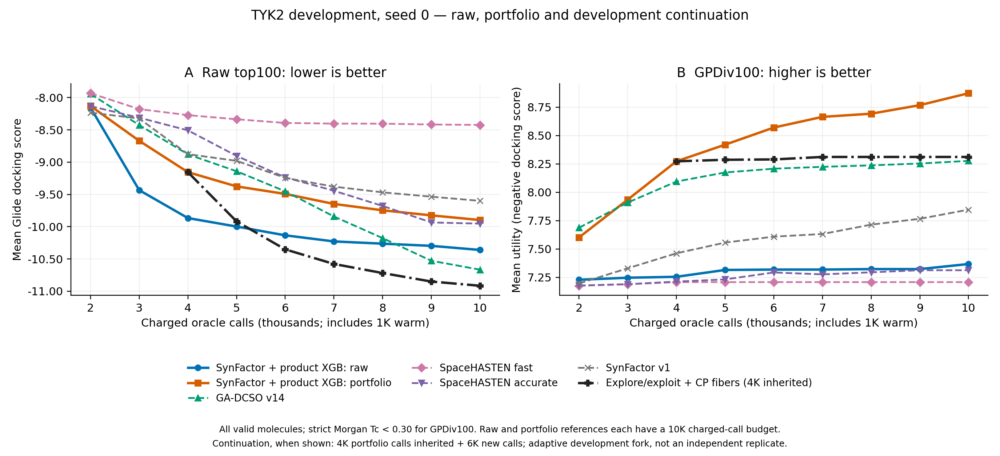

# TYK2: separate raw-score and diverse-portfolio search

This is a seed-0 development comparison on the full Freedom space:
296,350,180,179 routes. Two independent SynFactor + product-XGBoost policies
start from the same 1,000 charged warm attempts and each have their own
10,000-attempt budget. The first two adaptive rounds were inspected before
continuing both unchanged policies. No druglike filtering is applied.

The aggregate [comparison.csv](comparison.csv) uses the latest budget shared by
both policies and all controls. [trajectories.csv](trajectories.csv) contains all
completed evaluated prefixes; no incomplete run is extrapolated. Final 10k
OPDiv certification and bounds are in [opdiv_bounds.md](opdiv_bounds.md).

The portfolio reference reaches **certified OPDiv100 8.98048**, compared with
**8.42479 for GA-DCSO v14**, at 10,000 charged evaluations. At only 5,000 calls,
it already has a verified feasible portfolio of **8.43445**, slightly above
GA's final certified optimum. The raw-focused reference finishes at mean
top-100 **−10.36050**, behind GA's **−10.66600**, despite its early lead.

An additional development continuation inherits the portfolio policy's first
4,000 charged observations, then switches to 1,000 greedy XGBoost selections
per round and appends CP-optimized one-slot substitutions around diverse
observed anchors. Its matched-budget results are recorded separately in
[development_branch_comparison.csv](development_branch_comparison.csv). The
first continuation models are identical to the corresponding parent models;
only proposals and acquisition differ at that point. All subsequent fits use
only the continuation's own observations. Chirality features, tail weighting
and parent-residual correction remain disabled.

This continuation completes 10,000 charged evaluations with mean top-100
**−10.91500** and best score **−11.670**, versus GA's **−10.66600** and
**−11.380**. It passes GA's final top-100 mean at 8,000 calls (**−10.71820**).
The raw-score and portfolio wins use different acquisition policies; their
observations are not pooled into a single purported 10k result.

| Method, 10,000 charged attempts | Mean top-100 docking ↓ | GPDiv100 ↑ | OPDiv100 ↑ |
|---|---:|---:|---:|
| GA-DCSO v14 | −10.66600 | 8.27683 | 8.42479 |
| SynFactor explore/exploit continuation | **−10.91500** | 8.31144 | 8.37935 |
| SynFactor portfolio reference | −9.89696 | **8.87306** | **8.98048** |
| SynFactor raw reference | −10.36050 | 7.36727 | 7.45722 |
| Previous SynFactor + information | −9.60007 | 7.84670 | 7.93245 |
| SpaceHASTEN accurate | −9.95294 | 7.31244 | [7.331730, 7.377174] |
| SpaceHASTEN fast | −8.42417 | 7.20773 | 7.21263 |

OPDiv values are certified optima over each acquired canonical molecule set,
except the explicitly bounded SpaceHASTEN accurate result (see verification
below). The continuation's exact OPDiv is slightly below GA's: this is a
tradeoff between objectives, not one policy winning both.



## What changed

Both predictors fit acquired docking scores directly, independently:

- Neural CP64 proposes a global top-100k shortlist using a streaming GPU sweep.
- Full-product Morgan XGBoost reranks it together with observed-hit neighbors
  and a uniform route pool. Its tree hyperparameters match archived GA-v14.
- The raw policy takes 900 high-prediction molecules and 100 quality-qualified
  CP/XGB rank-disagreement candidates. Close analogues are allowed.
- The portfolio policy takes nine successive strict GPDiv100 groups, plus 100
  disagreement candidates. Pairwise Tanimoto < 0.30 is enforced within each
  group; different groups can explore analogues of the same series.

No factor-to-XGBoost distillation, reaction quotas, archived winner seeding or
unqueried docking labels are used. Each branch trains only on its own charged
history. Docking failures remain charged. Duplicate routes and canonical
molecules are excluded from new acquisition.

The [implementation protocol](../../../experiments/docking/TYK2.md) contains
commands and model details. The optional CP fiber helper, chiral predictor
features and tail weighting are **not** used in these frozen reference arms.

## Fair comparison and limits

Controls are unchanged archived GA-DCSO v14, SpaceHASTEN fast/accurate, and the
previous CP64 + information policy. Evaluation reconstructs complete charged
prefixes, including failures, and checks warm-start and docking-grid identities.
Molecules are canonicalized and duplicate structures retain their best valid
score. All portfolio metrics use nonchiral full-product Morgan radius-2,
2,048-bit fingerprints, strict Tc < 0.30 and k=100. Lower raw docking means and
higher portfolio utilities are better. GPDiv is a greedy feasible portfolio;
OPDiv solver bounds/certification are reported separately.

This is development on one target and seed, not an independent multi-seed
confirmation. The two proposed policies have separate budgets; their observations
are never pooled to construct one purported 10k result. Shared warm evaluations
are counted in each arm. Although tree hyperparameters match, full-product
fingerprints differ from GA's synthon-OR representation. Therefore a difference
from GA cannot be attributed solely to the CP proposal algorithm. A matched
product-XGBoost search control remains useful for attribution.

Reported search time includes model fitting, Cartesian scoring, bounded-pool
assembly/fingerprinting and acquisition. Oracle time is recorded separately.
Initialization, transport and interleaving waits are not included in their sum.
The two policies were interleaved on one docking instance, so their launch-to-end
wall times are not standalone method runtimes.

The three completed histories each contain 10,000 charged attempts. This
development phase submitted 24,000 new docking attempts: 9,000 for each reference
and 6,000 for the continuation, in addition to the pre-existing shared warm
start. The continuation counts its inherited 4,000 calls within its own budget.
Label-free native-assembly caches are shared; no docking scores are shared
between the independent reference arms or imported from later parent rounds.

| Policy | Fitting and search | Timed docking | Sum of timed stages |
|---|---:|---:|---:|
| Raw reference | 16m 54s | 19m 16s | 36m 10s |
| Portfolio reference | 19m 17s | 13m 40s | 32m 57s |
| Explore/exploit continuation | 18m 37s | 12m 05s | 30m 42s |

[timings.csv](timings.csv) retains seconds. These sums include the inherited
prefix for the continuation and exclude warm-oracle generation, initialization,
preflight, transport, untimed remote assembly and posthoc evaluation.

For SpaceHASTEN accurate, the fresh solver runs retain their recorded feasible
value 7.31244. Its earlier 100-molecule incumbent was independently checked
against both current canonical domains and remains valid, with maximum pairwise
Tc 0.298246. Combining that stronger known lower bound with the current global
upper bound gives **[7.331730, 7.377174]**, not a certified optimum. The
[verification record](spacehasten_accurate_incumbent_verification.json) preserves
this distinction rather than silently rewriting the recorded solver runs.

## Diagnostics and literature

The [diagnostics](diagnostics) directory includes reproducible retrospective
checks using warm data and observations already acquired by the respective
branches. These are selected-pool diagnostics, not independent acquisition wins.

- The first global CP shortlist spans six reactions and its score-ordered
  strict-GPDiv scan finds 43 representatives. This is a greedy count, not a
  certified packing upper bound. Global proposals still supply 83 of the first
  batch's realized top-100 scores, so they are useful for exploitation.
- The warm CP validation NMSE is 1.146 versus a constant-model baseline of
  1.205. It learns some signal, but its generalization is weak at this stage.
- Bounded top-tail weighting improves RMSE but worsens ranking in the first
  acquired batch. Uniform training is retained.
- Removing the first 100 disagreement labels improves prediction on the second
  selected batch. This conditional ablation has unequal training counts and
  does not establish a causal advantage for another acquisition policy.
- Chirality distinguishes many otherwise identical fingerprint vectors, but
  retrospective tail-ranking improvements are mixed across two later batches.
- Adding a nearby parent's observed-minus-predicted residual also has mixed
  ranking effects and increases prediction optimism for the tested offspring.
  Parent underprediction does not establish that the residual transfers to
  substituted molecules; this correction is not enabled.

The [reading notes](../../../experiments/docking/MODEL_OPTIMIZATION_READING.md)
cover surrogate overoptimization, conservative objectives, trust regions,
max-value entropy search, batch information gain and adaptation to the search
distribution. Our disagreement heuristic is not optimal Bayesian information
acquisition, and geometric diversity is not itself mutual information.

## Reproduction and provenance

`collect_results.py` exports aggregate metrics and whitelisted provenance only;
no molecule structures or complete library data are included. From the repo root:

```bash
python benchmarks/docking_fullspace/tyk2_v2/collect_results.py
```

The exact search sources are identified by [pilot_source_manifest.json](pilot_source_manifest.json).
The pilot used an immutable source snapshot. Subsequent driver changes add
resume validation and optional experiments. For exact
search-source reconstruction in a separate clean checkout, apply
[pilot_driver.patch](pilot_driver.patch) with `git apply --unidiff-zero`. Evaluation uses the checked-in
`tyk2_evaluate.py`; the unused evaluator draft in the original search snapshot
is deliberately excluded from the search manifest. Full local state, proposals,
responses and source snapshots remain under `runs/tyk2_v2` and are ignored by git.
The continuation's frozen search sources are recorded separately in
[branch_source_manifest.json](branch_source_manifest.json); its first-fit
identity check and proposal-source yields are included in `diagnostics/`.
