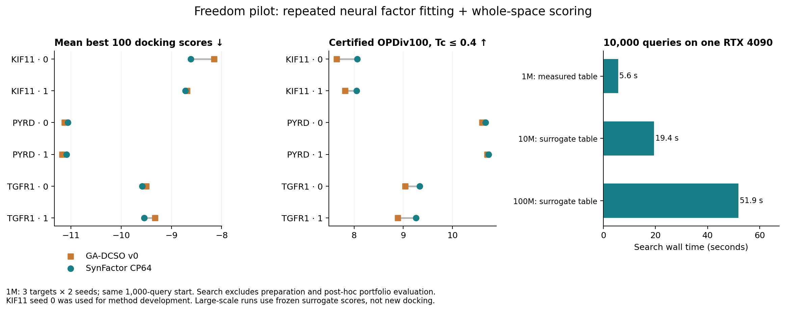

# SynFactor docking-search pilot — 16 November 2026

**Actionable first result:** iterative CP64 with an additive term and modest
diversity penalty improves certified OPDiv100 over unchanged GA-DCSO v0 in
all six Freedom 1M target/seed runs, using 10,000 oracle queries each. Mean
best-100 raw docking score improves in four of six; GA wins both PYRD cells.
This is promising preliminary evidence, not a completed multi-space study.

[Full numerical table](results.csv) · [paired OPDiv bounds](opdiv_paired.csv) ·
[independent audit](audit.md) · [code and reproduction](../../experiments/docking/README.md) ·
[PDF figure](comparison.pdf)

## 1M measured-Glide comparison

990,610 unique product IDs; three targets × seeds 0 and 1. Each paired run
starts from the same ordered 1,000 queries, then receives the same total
10,000-query budget. Raw-score optimization uses negative raw Glide utility;
failures consume calls and return zero. KIF11 seed 0 was the development cell;
the chosen settings were frozen before evaluating the other five cells.

The table reports means across the two seeds. Lower raw docking score is
better; higher OPDiv is better. Best-100 raw scores use distinct canonical
molecules. OPDiv100 selects 100 distinct queried molecules with every pair
having Morgan radius-2/2048 Tanimoto ≤ 0.4. Every primary solve reached certified
optimality over its **full queried archive**, not over the entire library.

| Target | GA-DCSO v0 top-100 | SynFactor top-100 | GA-DCSO v0 OPDiv100 | SynFactor OPDiv100 |
| --- | ---: | ---: | ---: | ---: |
| KIF11 | −8.418 | **−8.669** | 7.729 | **8.056** |
| PYRD | **−11.154** | −11.075 | 10.650 | **10.703** |
| TGFR1 | −9.412 | **−9.562** | 8.964 | **9.294** |

All six OPDiv gains are certified: SynFactor's feasible lower bound exceeds
the baseline upper bound. GPDiv100 also improves in all six cells. The gains
are small on PYRD, and two seeds are insufficient for a broad significance
claim. The development cell is included transparently, not counted as an
independent validation result.

SynFactor search takes **5.39–5.76 seconds** on the RTX 4090; GA-v0 takes
10.07–12.64 seconds on CPU. These times include fitting, scoring, acquisition
and cached table queries. They exclude imports/cache loading, original
enumeration/fingerprint generation, cache preparation and portfolio evaluation.
Cache preparation from the existing 1M fingerprint cache took another 5.77 s.
These are **not live docking runtimes**.

### Stronger and alternative controls

The unchanged archived **GA-DCSO v12 benchmark implementation** was also rerun on KIF11 seed 0, retaining
its 20 × 500-query schedule and XGBoost CUDA implementation. It took 42.16 s;
mean top-100 was −7.845 and certified OPDiv100 was 7.664, versus SynFactor's
−8.612 and 8.063. This is one supplementary cell, not a complete v12 matrix.
This archived implementation adapts production v12 to the frozen-oracle
benchmark; it uses XGBoost in place of the production two-stage LightGBM and
folds some operators. It is not the full production optimizer.

Fresh and historical **SpaceHASTEN-style** results are separately identified
in `results.csv`. The available local implementation uses per-reaction
ExtraTrees, product-fingerprint features and product-weighted routing. It is
an adaptation, **not native FTrees/SpaceLight SpaceHASTEN**. Historical utility
traces optimized the stored LLE-like objective; they cannot serve as matched
raw-objective evidence. Native FTrees/SpaceLight query traces were not available
locally for the same portfolio re-evaluation.

A fresh raw-objective adapted SpaceHASTEN run on KIF11 seed 0 took 85.34 s
for 10,000 unique calls. Its mean top-100 score was −8.186 and GPDiv100 was
7.188, compared with SynFactor's −8.612 and 7.997. Its OPDiv solver timed out
at 30 s with a feasible value 7.189 and upper bound 7.413. SynFactor's
certified 8.063 exceeds that bound, proving the portfolio advantage for these
queried archives even though the baseline optimum was not solved exactly.
The adaptation retains its own initialization and routing, so only the total
budget and raw objective are matched; the warm starts differ.

### Chemistry and objective caveats

The source column named `glide_le` is `−raw Glide − MolLogP`, zeroed on
filtering/docking failure; it is not heavy-atom ligand efficiency. We reran
the primary baselines on raw Glide to remove this objective mismatch.

The primary raw-score analysis includes finite scores for molecules that fail
the benchmark's chemistry filter. In supplementary target-valid route-level
top-100 analysis, SynFactor improves over GA-v0 in all six cells, but returns
**fewer valid compounds overall in all six**. The KIF11 valid-only top-100
comparison with v12 is essentially tied (−7.422 versus −7.420). Thus raw-score
and portfolio improvements do not establish improved overall chemistry yield.
Target-valid includes docking success and is never used as a free prefilter.
See the audit for exact counts and the route/molecule distinction.

## Scale-up: frozen docking-surrogate oracle

These runs use KIF11 seed 0 and the same 10,000-query budget. The 10M and 100M
tables contain frozen model predictions, **not measured docking results**.
Baseline archives are re-evaluated against the same table and molecule-level
portfolio convention; their historical wall times are not inferred here.

| 10M method | Mean top-100 ↓ | Global top-1,000 IDs recovered | GPDiv100 ↑ |
| --- | ---: | ---: | ---: |
| SynFactor CP64, no diversity | **−8.089** | **471 / 1,000** | 7.450 |
| GA-DCSO v12 | −7.911 | 154 / 1,000 | **7.466** |
| GA-DCSO v0 | −7.882 | 118 / 1,000 | 7.383 |

The initial plain-CP 10M search took **19.41 s**. It wins on score and global
tail recovery, but narrowly loses to v12 on GPDiv. This was a scale pilot,
with the earlier warm-start alias handling; the frozen 1M comparison has the
audited exact GA-v0 warm start. Large-scale follow-ups are explicitly recorded
as development rather than silently replacing the initial result.

Transferring the frozen 1M diversity setting to 10M gave mean top-100 −8.099,
GPDiv100 **7.46576**, and 12.37 s search time. This essentially closes the
portfolio gap to v12 (7.46604), while retaining better top scores. It does not
establish a diversity win. The earlier plain run used a different warm start
and ran under different load, so their wall-time difference is not evidence
that adding diversity makes the implementation faster.

The 100M file contains duplicate product IDs with differing structures and
scores. The first row selected by the public indexed oracle defines the shared
identity policy. The initial row-based CP run was invalidated when it was found
to query a different alias; it must not be compared with historical GA results.
Only a corrected run with canonical product-ID charging can enter the result
table. The source table's row count and unique-ID count are reported separately.

The corrected 100M search completed in **51.90 s**, with exactly 10,000 unique
product-ID calls and every returned utility checked against the native indexed
oracle. There are 99,851,700 source rows but **99,845,070 unique product IDs**;
6,630 later aliases are excluded. Cache preparation took 210.4 s plus a 10.8 s
identity audit, using existing source data and no full product-fingerprint
array. The original invalid run is excluded from the report by code.

| 100M method | Mean top-100 ↓ | Mean top-1,000 ↓ | Global top-1,000 IDs recovered | GPDiv100 ↑ |
| --- | ---: | ---: | ---: | ---: |
| SynFactor CP64, no diversity | −8.480 | **−8.169** | **437 / 1,000** | 7.302 |
| GA-DCSO v12 | **−8.490** | −8.144 | 392 / 1,000 | **7.651** |
| GA-DCSO v0 | −8.336 | −7.973 | 154 / 1,000 | 7.401 |

This is **not a 100M win over v12**: CP recovers more of the deep tail, but
v12 has slightly better best-100 scores and substantially better portfolio
diversity. That isolates coverage as the immediate optimization problem.
The current DCRF convention uses the released source-row count; recall itself
uses verified unique top-k IDs. Historical GA archives contain sorted ID sets,
not query-order traces, so only final-budget comparisons are valid.
An additional molecular-identity audit found that repeated canonical molecules
have identical surrogate scores in all four historical 10M/100M GA archives.
Their representative choice therefore does not change the molecular scores
or fingerprints. The evaluator retains the first supplied representative and
does not pretend sorted archives preserve query order.

A targeted 100M follow-up uses **synthon-OR diversity**: approximate fingerprints
are formed only for shortlisted products by OR-combining capped-synthon Morgan
bins. It needs no full-product fingerprint cache and no additional labels.
At diversity strength 0.5, GPDiv rises from **7.302 to 7.439**, global top-1,000
recovery rises from **437 to 446**, and mean top-100 changes to −8.471. Search
took 46.20 s. It now beats GA-v0 on these scores and GPDiv, but **still does not
beat v12 on best-100 score or diversity**. This is a separate development
follow-up, not part of the frozen six-run comparison. Its shorter runtime than
plain CP is not evidence that adding work is faster; timings are single runs.

## What the method search taught us

We tried plain CP16, CP16→CP64→LightGBM screening, direct CP64, diversity
strengths 0.5 and 2, a three-member uncertainty ensemble, and frozen CheMeleon
features. All usable KIF11 development results are in
[`development.csv`](development.csv); the two first runs made before correcting
the ambiguous-ID fingerprint alignment are excluded as invalid.

The direct **CP64 + additive + diversity 0.5** configuration was the best
simple portfolio choice and became the frozen 1M setting. The rank cascade
and product-fingerprint reranking did not improve it in this pilot. Ensemble
disagreement improved some top-score recovery but cost more and had lower
GPDiv. CheMeleon features did not outperform the inexpensive capped-synthon
Morgan features here. These are development observations, not controlled
causal ablations: several configurations change more than one component.

The first development runs used 998/1,000 of the native GA warm-start IDs
because reused synthon-ID aliases were skipped. This was fixed before the
frozen six-run comparison; the exact original driver is archived as
[`frozen_run.py`](frozen_run.py) and its SHA matches `frozen_protocol.json`.
Later changes add lazy fingerprint loading and canonical-ID handling for
100M; the archived driver remains the exact primary-result source.

## Highest-value next experiments

1. **Improve portfolio coverage at 100M.** The 10M transfer nearly matches v12
   GPDiv, and the 100M synthon-OR follow-up improves over plain CP, but v12 still
   leads at 100M. Test wider acquisition shortlists, reaction coverage and a
   portfolio-marginal acquisition score before adding a more expensive reranker.
2. **Integrate streaming Cartesian top-k with the full Freedom/Enamine space.**
   The present driver exploits cached factors but still visits enumerated
   rows. Use blocked matrix products and bounded candidate pools, assembling
   and fingerprinting only shortlisted products. Report end-to-end wall time,
   memory, real oracle calls and a useful final diverse portfolio.
3. **Run a matched live-docking comparison on additional targets**, including
   the production GA-v12 and native SpaceHASTEN where available. Keep the query budget
   and chemistry constraints fixed; separate oracle time from search overhead.
4. **Optimize the portfolio objective directly.** The current soft novelty
   penalty is only a proxy. Acquisition based on marginal portfolio improvement
   plus model uncertainty could improve PYRD and larger-space diversity without
   making factor scoring expensive. This should be a new development stage,
   followed by fresh targets/seeds rather than retuning the current test cells.

The strongest scientific story suggested by these results is **budgeted online
factor learning with rapid whole-space candidate scoring and diverse portfolio
recovery**. Better docking energies alone are mixed; the consistent portfolio
gain is the more distinctive preliminary result. Full-space live docking,
additional targets and a native SpaceHASTEN comparison remain outstanding.

## Artifacts

`results.csv` separates matched raw, stronger-control, historical-different-
objective and surrogate-scale groups. `runs/` bundles compressed ordered query
traces, configurations, timing/fit histories, score summaries and exact solver
bounds for fresh runs. Large product/fingerprint caches remain outside Git.
`manifest.json` records source and trace hashes; `environment.json` records
training and evaluation environments. The evaluation RDKit version differs
from feature preparation, but is identical across compared archives.

Validation: all 23 tests pass, including instrumented oracle-access checks,
canonical-ID charging and lazy synthon-diversity selection. After the identity
repair, the final driver reproduced the complete frozen KIF11 seed-0 trace
exactly. The subsequent optional synthon-diversity branch was checked to retain
identical selection for the default product-fingerprint mode.

No SynthonBench implementation or paper-source repository was modified.
